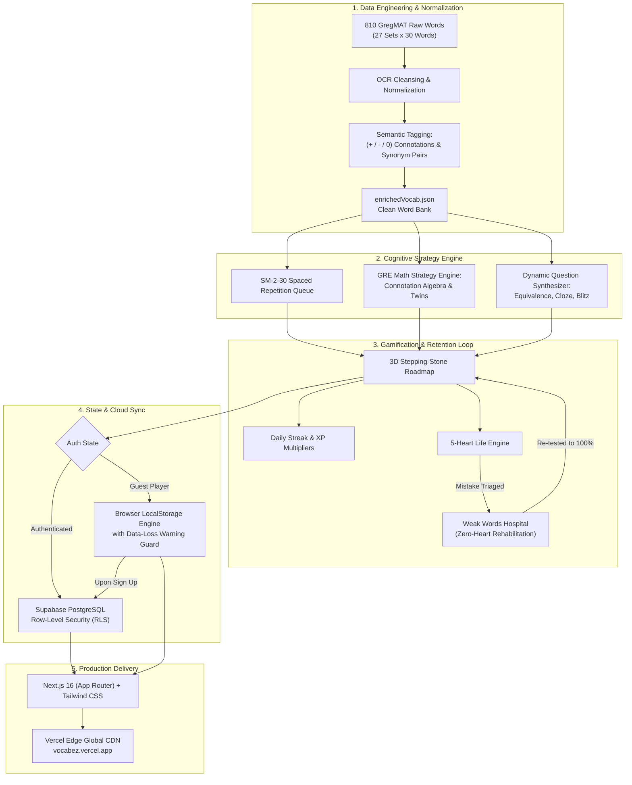

# VocabEz

Master all **810 GregMAT GRE Words** across 27 Sets in **30 Days** through Duolingo-style gamification, cognitive spaced repetition, and tactical GRE strategy drills.

**Live Application:** [https://vocabez.vercel.app](https://vocabez.vercel.app)

Test the live application directly in your browser at [vocabez.vercel.app](https://vocabez.vercel.app) to explore the 27-set learning roadmap, strategy practice hub, and audio pronunciation without local setup.

[](https://nextjs.org/)
[](https://react.dev/)
[](https://www.typescriptlang.org/)
[](https://tailwindcss.com/)
[](https://supabase.com/)
[](https://vocabez.vercel.app)
[](LICENSE)

---

## Live Demo

Experience the platform live on Vercel:
- **Production URL:** [https://vocabez.vercel.app](https://vocabez.vercel.app)
- **Guest Access:** Immediate play without login (persists locally).
- **Cloud Sync:** Optional Supabase sign-up to sync streaks, hearts, and mastery across devices.

---

## Overview

Conquering 810 high-frequency GRE words in one month is difficult with static flashcards. **VocabEz** bridges pedagogical memory science and gamified engagement:

1. **Duolingo-Inspired Learning Path:** Progressive stepping-stone roadmap spanning 27 Sets (30 words per set) with tactile 3D buttons, dynamic combo counters, level progression, XP, streaks, and a 5-heart mechanic.
2. **GregMAT Math & Polarity Strategy:** Classify words into **Positive (+)**, **Negative (-)**, or **Neutral (0)** charges to crack GRE Text Completion questions algebraically.
3. **Practice Anything Anytime Strategy Hub:** Train specialized GRE exam skills on demand without being restricted to linear sets.
4. **Weak Words Hospital:** Automatic triage clinic where incorrectly answered words are quarantined for targeted rehabilitation with zero heart penalty.
5. **Guest-First & Cloud-Synced:** Start practicing immediately without signing up (persisted in browser storage with data-loss warnings), and seamlessly sync all progress to Supabase Cloud once an account is created.

---

## Methodology

The design and development of VocabEz followed a five-stage engineering and cognitive science pipeline:

```
+---------------------------------------------------------------------------------------+
|                                  METHODOLOGY PIPELINE                                 |
+---------------------------------------------------------------------------------------+
|  1. DATA INGESTION & NORMALIZATION                                                    |
|     - Raw 810 GregMAT Vocabulary Dataset (27 Sets x 30 Words)                          |
|     - OCR Error Cleansing & Structural Validation                                     |
|     - Connotation Classification (+ / - / 0) & Synonym Twin Mapping                   |
|                                         |                                             |
|                                         v                                             |
|  2. COGNITIVE STRATEGY & QUESTION GENERATION                                          |
|     - SM-2-30 Spaced Repetition Scheduling (Capped to 30-Day Exam Horizon)            |
|     - Dynamic Question Synthesizer (Sentence Equivalence, Polarity, Context Cloze)    |
|     - Morphological Root Association (-loqu-, -path-, -bell-, -plac-)                 |
|                                         |                                             |
|                                         v                                             |
|  3. GAMIFICATION & HABIT MECHANICS                                                    |
|     - Duolingo-Style 3D Tactile Interactive Stepping-Stone Roadmap                    |
|     - 5-Heart Health Economy & Streak Multipliers                                     |
|     - Automatic Weak Words Hospital Triage for High-Yield Remediation                 |
|                                         |                                             |
|                                         v                                             |
|  4. RESILIENT STATE & HYBRID STORAGE                                                  |
|     - Zero-Friction Guest Mode with LocalStorage Engine & Loss Warning Guards         |
|     - Seamless Database Migration to Supabase Auth & PostgreSQL on Registration       |
|     - Row-Level Security (RLS) for Secure Cross-Device Continuity                     |
|                                         |                                             |
|                                         v                                             |
|  5. DEPLOYMENT & EDGE OPTIMIZATION                                                    |
|     - Next.js 16 App Router + React 19 SSR Architecture                               |
|     - Mobile-First Touch Targets (>= 46px) with Glassmorphism Navigation              |
|     - Production Build Deployed to Vercel Global Edge CDN (vocabez.vercel.app)        |
+---------------------------------------------------------------------------------------+
```

### Architectural Flowchart



---

## Practice Modes (Available Anytime)

| Mode | Strategy Focus | GRE Application |
| :--- | :--- | :--- |
| **Polarity Math** | Classify connotations into `+`, `-`, or `0` | Algebraic elimination in Text Completion |
| **Synonym Clusters** | Pair cross-set twins (*laconic* <-> *taciturn*) | Sentence Equivalence (finding twin pairs) |
| **Antonym Traps** | Dissect extreme opposites and contrasting meanings | Identifying contrast transitions (`although`, `despite`) |
| **Dual-Blank Context** | Fill-in-the-blank contextual drills | Real GRE Sentence Equivalence & Text Completion |
| **Weak Words Hospital** | Intensive rehabilitation of missed words | Eliminates blind spots (0 hearts lost) |
| **Speed Blitz** | 60-second rapid-fire active recall sprints | Fluency under GRE 30-minute section time pressure |

---

## The 30-Day Mastery Blueprint

The curriculum is structured across 4 progressive milestones:

```
[Day 1-7]   Unit 1: Foundations & Core Roots      (Sets 1-7   | 210 Words)  -> Milestone Mock 1
[Day 8-14]  Unit 2: Intermediate Nuance & Twins   (Sets 8-14  | 420 Words)  -> Midpoint Mock 2
[Day 15-21] Unit 3: Advanced Contrast & Traps     (Sets 15-21 | 630 Words)  -> Milestone Mock 3
[Day 22-27] Unit 4: Extreme Pejoratives & Nuance  (Sets 22-27 | 810 Words)  -> Ingestion Complete
[Day 28-30] Grand Gauntlet: Diagnostics & Top 50 Traps                      -> GRE Exam Ready
```

### Day-by-Day Schedule Summary

- **Days 1-27:** Ingest 1 Set (30 words) daily + dynamic spaced repetition review of previous sets.
- **Day 28:** Diagnostic Exam 1 (Sets 1-14 Mock - 100 Questions) + Weak Words Hospital purge.
- **Day 29:** Diagnostic Exam 2 (Sets 15-27 Mock - 100 Questions) + Secondary meanings review (*qualify*, *wax*, *check*).
- **Day 30:** 810-Word Gauntlet Marathon (rapid active recall) + Test-Day Strategy Checklist.

---

## Mobile-First Responsive Design

- **Touch Ergonomics:** All buttons engineered with >= 46px touch targets and 3D tactile push feedback.
- **Floating Bottom Nav:** Glassmorphism blurred dock for smooth thumb navigation between Learning Path, Practice Hub, Weak Words Hospital, Word Bank, and Profile.
- **Pronunciation Audio:** Real-time Web Speech API audio playback for all 810 target words and example sentences.
- **Data-Loss Protection:** Proactive warning banners alert guest users before clearing cache or closing incognito tabs.

---

## Architecture & Project Structure

```
VocabEz/
|-- src/
|   |-- app/
|   |   |-- dashboard/page.tsx       # 27-Set Stepping Stone Roadmap
|   |   |-- practice/page.tsx        # "Practice Anything Anytime" Strategy Hub
|   |   |-- session/[mode]/page.tsx  # Gamified Interactive Quiz Engine
|   |   |-- words/page.tsx           # Searchable 810-Word Bank + Audio
|   |   |-- profile/page.tsx         # User Stats, XP, Streaks & Accuracy
|   |   |-- login/page.tsx           # Supabase Auth Login
|   |   |-- signup/page.tsx          # Supabase Auth Registration
|   |   |-- layout.tsx               # Root Layout with Mobile/Desktop Nav
|   |   `-- globals.css              # Custom Duolingo 3D Tactile Styling
|   |-- components/
|   |   |-- navigation/              # Sidebar, TopNav, MobileNav
|   |   `-- ui/                      # Button3D, GuestWarningBanner
|   |-- data/
|   |   `-- enrichedVocab.json       # 810 Normalized GregMAT Words (Sets 1-27)
|   |-- lib/
|   |   |-- guestStorage.ts          # LocalStorage Engine + Supabase Cloud Sync
|   |   |-- questionEngine.ts        # Dynamic GRE Question Generator
|   |   `-- soundEffects.ts          # Web Audio Synthesizer (Correct/Wrong/XP)
|   |-- types/
|   |   |-- database.ts              # Supabase Database TypeScript Definitions
|   |   `-- vocab.ts                 # Vocabulary & Strategy Interfaces
|   `-- utils/
|       `-- supabase/                # SSR, Client, and Middleware Supabase Clients
|-- supabase/
|   `-- schema.sql                   # PostgreSQL Schema with Row-Level Security
|-- tailwind.config.ts               # Custom Duo Color Palette & Tactile Shadows
`-- package.json
```

---

## Database Setup (Supabase)

The database schema is defined in `supabase/schema.sql`.

### Tables

1. **`profiles`**: Tracks user `xp`, `streak`, `hearts`, `last_active_date`, and `daily_goal`.
2. **`user_word_progress`**: Tracks mastery per word (Box 1-5 in Leitner system, accuracy count, weakness flags).
3. **`user_sessions`**: Records completed practice sessions, score, accuracy, and timestamp.

### Setup Instructions

1. Open your project in the [Supabase Dashboard](https://supabase.com/dashboard).
2. Go to the **SQL Editor**.
3. Copy and run the contents of `supabase/schema.sql`.
4. Row-Level Security (RLS) is automatically enabled to ensure each user can only read/write their own records.

---

## Getting Started

### Prerequisites

- Node.js 18.17+ or Node.js 20+
- npm or pnpm

### Installation

1. **Clone the repository:**
   ```bash
   git clone https://github.com/nnfuad/VocabEz.git
   cd VocabEz
   ```

2. **Install dependencies:**
   ```bash
   npm install
   ```

3. **Configure Environment Variables:**
   Create a `.env.local` file in the root directory:
   ```env
   NEXT_PUBLIC_SUPABASE_URL=https://your-project.supabase.co
   NEXT_PUBLIC_SUPABASE_PUBLISHABLE_KEY=your-supabase-publishable-key
   ```
   *(Safe fallback defaults are configured in the code so you can run locally right away).*

4. **Start the Development Server:**
   ```bash
   npm run dev
   ```

5. **Open the App:**
   Visit [http://localhost:3000](http://localhost:3000) or [http://localhost:3001](http://localhost:3001) in your browser.

---

## Deploy to Vercel

VocabEz is deployed live at [https://vocabez.vercel.app](https://vocabez.vercel.app).

To deploy your own fork to Vercel:

1. Push your changes to GitHub (`git push origin main`).
2. Go to [Vercel Dashboard](https://vercel.com/new).
3. Select **Import Git Repository** and choose `nnfuad/VocabEz`.
4. Add the two environment variables (`NEXT_PUBLIC_SUPABASE_URL` and `NEXT_PUBLIC_SUPABASE_PUBLISHABLE_KEY`).
5. Click **Deploy**.

---

## License

This project is licensed under the MIT License - see the [LICENSE](LICENSE) file for details.
